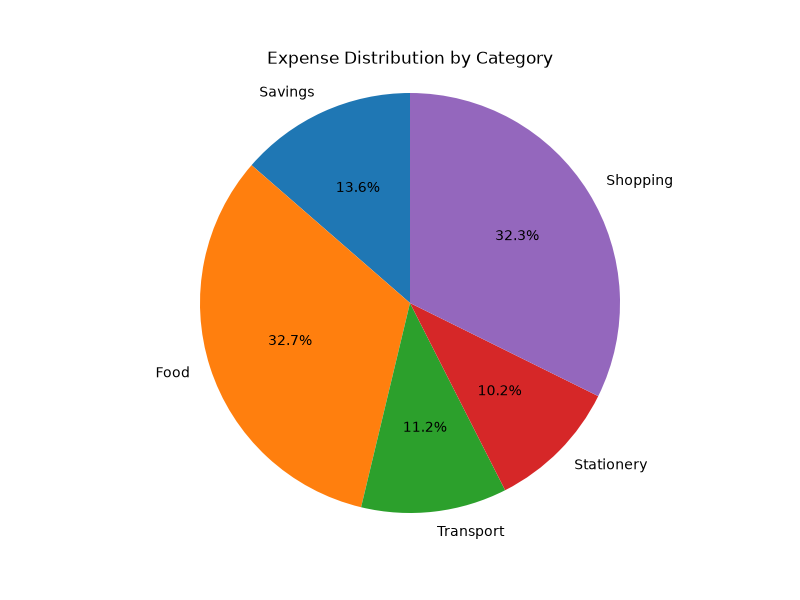
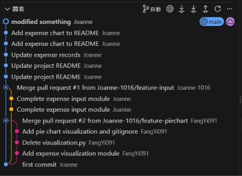
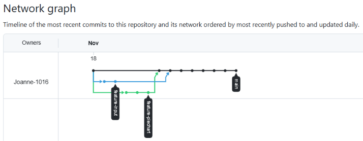

# ExpenseTracker

## 1. Project Overview

ExpenseTracker is a Python-based expense tracking system that allows users to record daily expenses and visualize spending by category using a pie chart.

## 2. Features

- **Expense Input:** Add expense records including date, amount, category, and notes.
- **CSV Storage:** Store expense records in `expenses.csv`.
- **Data Validation:** Validate user input, including date format and expense amount.
- **Data Visualization:** Display expense distribution by category using a pie chart.

## 3. Project Structure

```text
ExpenseTracker/
│
├── input.py
├── visualization.py
├── expenses.csv
├── README.md
└── .gitignore
```

## 4. Requirements

- Python 3
- matplotlib

Install the required library:

```bash
pip install matplotlib
```

## 5. How to Run

1. Clone the repository.
2. Open the project folder.
3. Run the input module:

```bash
python input.py
```

4. Follow the menu to add expense records.

5. Run the visualization module:

```bash
python visualization.py
```

## 6. Data Format

Expense records are stored in `expenses.csv`.

| Field | Description |
|---|---|
| date | Expense date |
| amount | Expense amount |
| category | Expense category |
| notes | Expense description |

Example:

```csv
date,amount,category,notes
2026-11-03,200.0,Savings,Allowance
2026-11-05,300.0,Food,Lunch
2026-11-13,120.0,Transport,Train
2026-11-15,45.0,Transport,Bus
2026-11-15,180.0,Food,Dinner
2026-11-17,150.0,Stationery,Book
2026-11-18,475.0,Shopping,Clothes
```

## 7. Expense Visualization

The following pie chart shows the distribution of expenses by category.



The chart visualizes the total expenses for each category, helping users understand their spending habits.

## 8. Git Branch Management and Collaboration

This project uses Git and GitHub for version control and team collaboration. Each team member develops their assigned features in separate branches and merges completed work into the main branch through Pull Requests.

### 8.1 VS Code Git Graph

The following screenshot shows the commit history and branch management in Visual Studio Code, including feature development and merge operations.



### 8.2 GitHub Network Graph

The following screenshot shows the repository's network graph on GitHub, illustrating the commit and branch history.



### 8.3 Collaboration Workflow

1. Create separate feature branches for different tasks.
2. Implement and test features independently.
3. Commit and push changes to GitHub.
4. Create Pull Requests for code integration.
5. Review and merge completed features into the main branch.


## 9. Team Contributions

| Member | Student | Responsibility |
|---|---|---|
| Member A | 1132937 林郁潔 | Expense Input Module |
| Member B | 1132935 李芳儀 | Data Visualization Module |

## 10. Repository

GitHub: https://github.com/Joanne-1016/ExpenseTracker